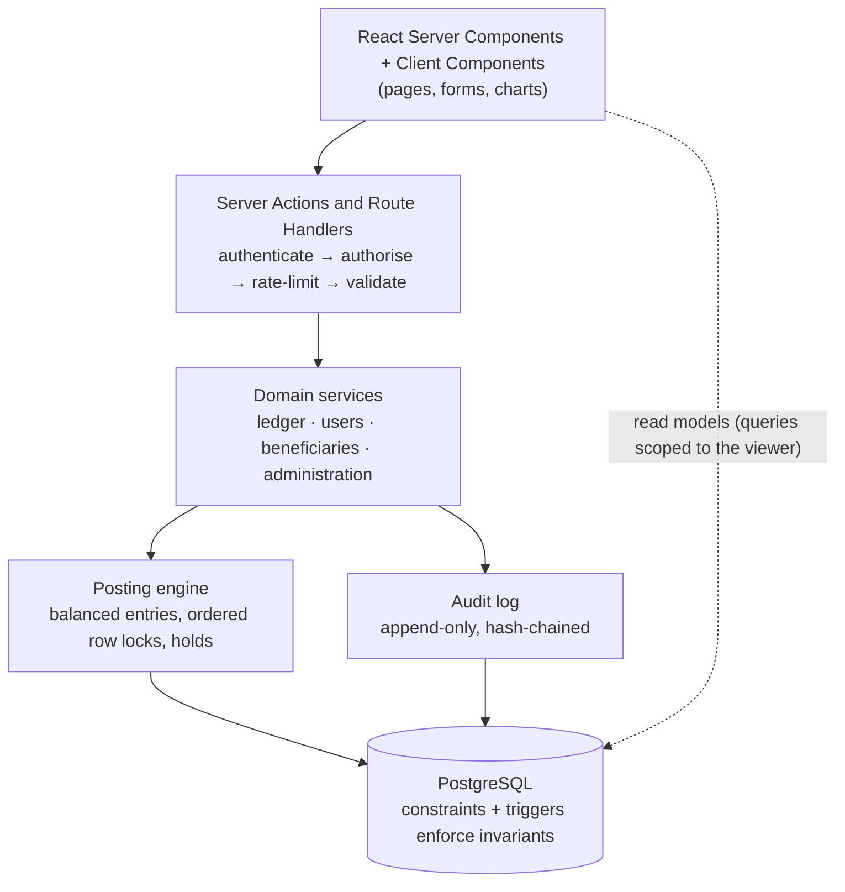
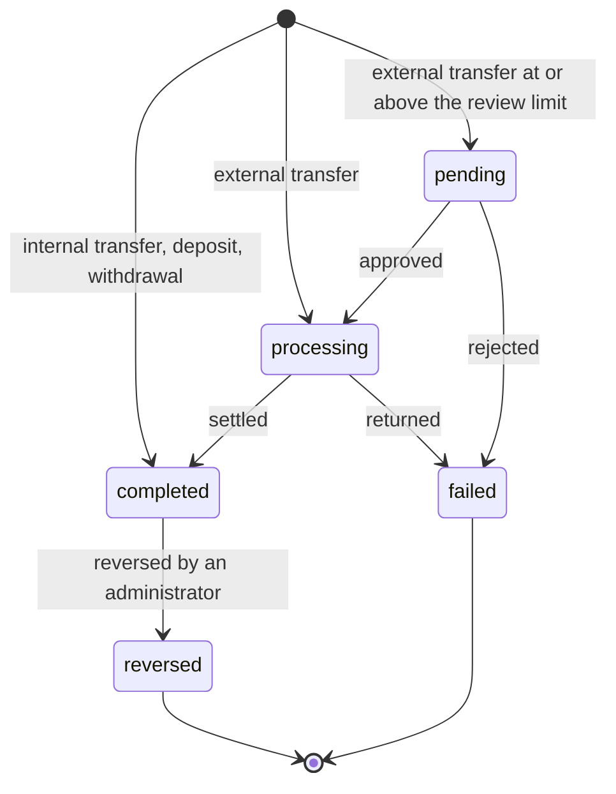

# Aldera

**A digital banking and financial operations platform built on a double-entry ledger.**

Aldera is a complete, working reference application for a high-integrity financial system: multi-currency accounts, transfers with review and settlement, real-time transaction tracking, an operations console and a tamper-evident audit trail. It is designed to show how a financial product stays correct under retries, concurrency and human error, without reaching for infrastructure it does not yet need.

The interface is in Latin American Spanish; the code, comments and this document are in English.

> Aldera is a fictional institution created for demonstration. It is not a bank, holds no licence, makes no claim of regulatory certification, and moves no real money.

---

## Contents

- [Try it](#try-it)
- [What is in the product](#what-is-in-the-product)
- [Architecture](#architecture)
- [Financial integrity decisions](#financial-integrity-decisions)
- [Data model](#data-model)
- [Transaction lifecycle](#transaction-lifecycle)
- [Security model](#security-model)
- [HTTP API](#http-api)
- [Stack](#stack)
- [Local setup](#local-setup)
- [Environment variables](#environment-variables)
- [Database](#database)
- [Testing](#testing)
- [Deployment](#deployment)
- [Project structure](#project-structure)
- [Known demo limitations](#known-demo-limitations)
- [Path to production scale](#path-to-production-scale)

---

## Try it

**Live demo: <https://aldera-financial-platform.vercel.app>**

The sign-in page offers one-click access to three seeded profiles. The same credentials can be typed in by hand.

| Role | Email | What you see |
| --- | --- | --- |
| Customer | `elena@aldera.example` | A business owner with four accounts (USD and EUR), eight beneficiaries and six months of activity |
| Operator | `ops@aldera.example` | The operations console: review queue, settlement monitoring, account controls |
| Administrator | `admin@aldera.example` | Everything an operator sees, plus user management, reversals and audit verification |

Password for all demo profiles: `Aldera-Demo-2026`

A suggested five-minute tour:

1. Sign in as the **customer** (*Cliente*). The overview (*Resumen*) shows total and available balance, cash flow and items needing attention.
2. Open **Transferir** and send an amount to a saved beneficiary. Watch the receipt move from *En proceso* to *Completada*.
3. Send **$10,000 or more** to an external beneficiary. It is held as *Pendiente de revisión*, and the available balance drops while the current balance does not.
4. Sign out and sign in as the **operator** (*Operador*). Approve or reject the held transfer from the review queue (*Cola de revisión*); every decision asks for a reason.
5. Sign in as the **administrator** (*Administrador*). Reverse a completed transaction, then open **Registro de auditoría** and see each of those actions recorded, with the chain verified.

---

## What is in the product

**For customers**

- **Overview** – total balance, available balance, 30-day money in and out with period comparison, transaction volume, account cards, a cash-flow chart (with a table view), security and account notices, recent activity and quick transfer.
- **Accounts** – current, available and reserved balances per account; a statement read directly from ledger entries, each line showing the balance it produced.
- **Transactions** – search plus filters for type, status, account and date range (held in the URL), pagination and CSV export. Each transaction has a receipt with its status history and ledger entries.
- **Move money** – a guided flow: source, destination, amount, review, confirmation, receipt. Validates balance, limits and currency before anything is sent.
- **Deposits and withdrawals** – add money to or withdraw from any account.
- **Beneficiaries** – external bank accounts and other Aldera customers (who are paid instantly).
- **Insights** – balance trend, monthly cash flow, spending by category, top counterparties.
- **Notifications**, **profile** and **security settings**, including recent sign-in activity.

**For operations staff**

- **Operations overview** – key metrics, the review queue, transactions by status, and a live **ledger integrity report**.
- **Transaction monitoring** – every transaction on the platform, with approve, reject, settle, fail and reverse actions gated by role.
- **Users** and **accounts** – suspend or reactivate users, change roles, freeze or unfreeze accounts; the bank's own ledger accounts are visible too.
- **Audit log** – filterable, with hash-chain verification.

---

## Architecture

The design goal is *simple now, extensible later*: one deployable application, one database, and clear seams where a larger system would split.



**Layers and their rules**

| Layer | Location | Responsibility |
| --- | --- | --- |
| Presentation | `src/app`, `src/components` | Rendering and interaction only. No business rules. |
| Edge | `src/server/actions`, `src/app/api` | The trust boundary. Every Server Action goes through one wrapper (`defineAction`) that authenticates, checks the role, rate-limits, validates input with Zod, and converts failures into a typed, client-safe result. |
| Domain | `src/server/ledger`, `users`, `beneficiaries`, `admin` | Plain TypeScript functions that take a database handle and a `RequestContext` (who is acting, from where). They never read cookies or headers, which is why they are tested directly. Authorization is re-checked here, so a mistake at the edge alone cannot grant access. |
| Read models | `src/server/queries` | Queries that are scoped to what the viewer may see. A customer's queries always filter by the accounts they own. |
| Persistence | `src/db` | Schema, plain-SQL migrations, and the integrity constraints that hold regardless of application code. |

Every domain operation runs in **one database transaction**: the transaction record, its ledger entries, balance updates, status event, audit record and notifications commit together or not at all.

---

## Financial integrity decisions

These are the decisions that matter most in a system that moves money. Each one is enforced in code and covered by tests.

### 1. Balances are derived from a double-entry ledger

There is no "set balance" operation anywhere in the system. Money moves only by posting a set of entries in which **total debits equal total credits**. Each customer movement has a bank-side leg in a system account (clearing, payments in transit, fee income, interest expense), so the sum of every account balance in a currency is always exactly zero. Nothing is created or destroyed.

An account's stored balance is a running total kept alongside the entries for fast reads. It is updated in the same transaction as the entries, each entry records the balance it produced, and the integrity report re-derives it from scratch to prove the two agree.

### 2. The database refuses an inconsistent ledger

Application code can have bugs. The invariants therefore live in PostgreSQL as well (`src/db/migrations.ts`):

| Invariant | Mechanism |
| --- | --- |
| A transaction's entries must balance | Deferred constraint trigger, checked at `COMMIT` |
| Customer accounts cannot be overdrawn (including funds on hold) | `CHECK (allow_negative OR posted_minor - held_minor >= 0)` |
| Ledger entries, status events and audit records are append-only | `BEFORE UPDATE OR DELETE` triggers that raise |
| A transaction's amount, currency, accounts and idempotency key never change; it cannot be deleted | `BEFORE UPDATE OR DELETE` trigger |
| An idempotency key is recorded at most once per owner | Unique index |

`tests/integrity.test.ts` bypasses the service layer and attacks these directly with raw SQL to prove they hold.

### 3. Money is integer minor units, never floating point

Amounts are stored as `bigint` cents in PostgreSQL and handled as `bigint` in TypeScript. User input is parsed by digit manipulation (`parseAmount`), and anything that cannot be represented exactly is rejected rather than rounded: `10.999` is an error for a two-decimal currency. Display formatting passes an exact decimal string to `Intl.NumberFormat`. Amounts cross the network as decimal strings. The only place a JavaScript number touches money is chart geometry, clearly isolated in `toApproximateNumber`.

### 4. Every money movement is idempotent

Each request carries an idempotency key (generated once per reviewed instruction in the UI; supplied in the `Idempotency-Key` header on the API). The key and a fingerprint of the request are stored on the transaction.

- **Same key, same request** → the original transaction is returned. No second movement, no second audit record.
- **Same key, different request** → rejected with a conflict, never silently replayed.
- **Two identical requests racing** → the key is claimed with `INSERT … ON CONFLICT DO NOTHING` before any money moves; the loser returns the winner's transaction.
- A retry returns the original success even if the balance has since changed and a fresh request would fail.

### 5. Transfers are atomic and deadlock-free

Debit and credit are posted in one database transaction. All accounts involved are locked with `SELECT … FOR UPDATE` **in ascending id order**, so two transfers moving money in opposite directions between the same accounts queue rather than deadlock. Available funds are checked after the lock is held, which is what prevents concurrent requests from spending the same balance twice.

### 6. History is never edited

A transaction's status advances through a strict state machine and every change is recorded as an event. Corrections are made with a **reversal**: a new transaction that posts the exact inverse of the original's net effect on each account and links back to it. The original stays in place, marked *reversed*.

### 7. Sensitive actions are audited atomically

Audit records are written with the same database transaction as the change they describe, so there is never an action without its record, or a record of something that rolled back. Each record stores the hash of the one before it; altering or removing any historical record breaks the chain from that point on, which the audit page detects and reports.

### 8. Available balance is distinct from current balance

A transfer held for review does not move money. It places a **hold**: the current balance is unchanged, the available balance drops, and the held amount cannot be spent elsewhere. Approval converts the hold into posted entries; rejection releases it.

---

## Data model

| Table | Purpose |
| --- | --- |
| `users` | Identity, role (`customer`, `operator`, `admin`), status, scrypt password hash, security preferences |
| `accounts` | Customer and system accounts: currency, status, `posted_minor` (ledger balance), `held_minor` (reserved funds) |
| `beneficiaries` | Saved payees. `internal` beneficiaries point at another account on the platform |
| `transactions` | One row per business event: type, status, amount, currency, source and destination, idempotency key and request fingerprint, metadata |
| `ledger_entries` | The immutable double-entry postings: account, direction, amount, resulting balance |
| `transaction_events` | Append-only status history: from, to, actor, note |
| `audit_logs` | Append-only, hash-chained record of sensitive activity: actor, action, entity, metadata, IP, user agent |
| `notifications` | Per-user notices |

Identifiers are prefixed and unguessable (`txn_9f2c41d07ab35e6c8d10`); transactions also carry a short human reference (`TX-7Q4M9-K2P0X`).

---

## Transaction lifecycle



| Transition | Ledger effect |
| --- | --- |
| Create, internal | Debit source, credit destination |
| Create, external | Debit source, credit *payments in transit* |
| Create, held for review | No entries; funds placed on hold |
| Approve | Release hold; debit source, credit *payments in transit* |
| Reject | Release hold |
| Settle | Debit *payments in transit*, credit *external clearing* |
| Fail | Debit *payments in transit*, credit source (funds returned) |
| Reverse | New transaction posting the inverse of the original's net effect |

Policy values (review threshold of 10,000.00 and a per-movement limit of 250,000.00) are in `TRANSFER_POLICY` in `src/lib/domain.ts`.

---

## Security model

- **Authentication** – passwords hashed with scrypt and a per-password salt; sign-in compares against a decoy hash for unknown emails so timing does not reveal which addresses exist. Sessions are HS256-signed, HTTP-only, `SameSite=Lax` cookies with an 8-hour lifetime.
- **Sessions are re-validated on every request** – the cookie carries only a user id. The user is re-read from the database each time, so suspending a user or changing a role takes effect immediately.
- **Authorization in depth** – a request proxy keeps anonymous visitors out of the application shell, but it is a convenience. Every page, Server Action and route handler verifies the session and role itself, and the domain services check again.
- **Ownership checks that do not leak** – asking for another customer's account, transaction or beneficiary returns *not found*, the same as an id that does not exist.
- **Least exposure** – password hashes never leave the session module; customers see only the ledger legs on their own accounts; request metadata and bank-side entries are visible to staff only.
- **Input validation** – Zod schemas shared by forms and server; the server is always the authority. Search input is escaped before use in `LIKE` patterns. CSV export neutralises spreadsheet formula injection.
- **Rate limiting** – sliding-window limits on sign-in, registration, password reset and money movements, behind a small interface that a shared store can replace.
- **Safe errors** – domain errors carry a stable code and a user-safe message; anything unexpected is logged server-side with a correlation id and surfaced generically.
- **Content-Security-Policy** – set per request in `src/proxy.ts` with a fresh nonce: `script-src 'self' 'nonce-…' 'strict-dynamic'`, so only scripts the server emitted can run. `object-src`, `frame-src` and `frame-ancestors` are `'none'`; `base-uri`, `form-action` and `connect-src` are `'self'`. Because of the nonce, every page is rendered per request. Styles allow `'unsafe-inline'`, which chart geometry and popover positioning need as inline style attributes. API responses carry `default-src 'none'`.
- **Other headers** – `X-Frame-Options: DENY`, `nosniff`, strict referrer policy, a restrictive permissions policy, HSTS, `Cross-Origin-Opener-Policy` and `Cross-Origin-Resource-Policy: same-origin`, and `no-store` on authenticated pages and API responses.
- **Secrets** – configuration comes from environment variables only. Nothing sensitive is committed or sent to the browser.

---

## HTTP API

The web application uses Server Actions. The same transfer operation is also exposed over HTTP to show how an integration would call it:

```bash
curl -X POST "$BASE_URL/api/v1/transfers"   -H "Content-Type: application/json"   -H "Idempotency-Key: 2f0c1b7e-6a43-4d0e-9c55-7d1f0a9b3e21"   -b "aldera_session=$SESSION_COOKIE"   -d '{
        "sourceAccountId": "acc_...",
        "destination": { "kind": "beneficiary", "beneficiaryId": "ben_..." },
        "amount": "125.50",
        "description": "Invoice 2026-041"
      }'
```

- `201 Created` on the first request; `200 OK` with `Idempotent-Replayed: true` when the same key and body are sent again.
- `409` when a key is reused with a different body; `422` for validation, insufficient funds or policy limits; `401`/`403`/`404`/`429` as you would expect.
- Amounts are decimal strings in both directions.

Other endpoints: `GET /api/health` (readiness probe) and `GET /api/transactions/export` (CSV of the signed-in customer's transactions, honouring the list filters).

---

## Stack

| Concern | Choice |
| --- | --- |
| Framework | Next.js 16 (App Router, React Server Components, Server Actions), React 19 |
| Language | TypeScript, strict mode |
| Styling | Tailwind CSS v4, Radix UI primitives, lucide icons |
| Database | PostgreSQL. Any managed instance via `DATABASE_URL`, or an embedded engine (PGlite, PostgreSQL compiled to WebAssembly) when none is configured |
| Data access | Drizzle ORM for typed queries; hand-written SQL migrations |
| Validation | Zod |
| Sessions | `jose` (JWT, HS256) |
| Tests | Vitest, against a real PostgreSQL engine |

Charts are hand-built SVG with no charting dependency. The colour pair was validated for colour-vision deficiency, every chart has a keyboard-accessible readout, and exact figures are always available as text or a table.

---

## Local setup

Requirements: Node.js 22.12 or newer.

```bash
git clone https://github.com/Witcher-Geralt-of-Rivia/Bank.git
cd Bank
npm install
cp .env.example .env.local   # optional for local development
npm run dev
```

Open <http://localhost:3000>. With no `DATABASE_URL`, the development server starts on the embedded PostgreSQL engine, applies migrations and loads the demo dataset automatically. Nothing else needs to be installed.

Useful scripts:

| Script | Purpose |
| --- | --- |
| `npm run dev` | Development server |
| `npm run build` | Build the schema snapshot, then the production bundle |
| `npm start` | Serve the production build (requires `SESSION_SECRET` and `DATABASE_URL`) |
| `npm run lint` | ESLint |
| `npm run typecheck` | TypeScript, no emit |
| `npm test` | Test suite on the embedded engine |
| `npm run test:postgres` | The same suite against `TEST_DATABASE_URL` |
| `npm run check` | Lint, typecheck, test and build in sequence |

---

## Environment variables

| Variable | Required | Default | Purpose |
| --- | --- | --- | --- |
| `SESSION_SECRET` | **In production** | – | Key used to sign session cookies. At least 32 random characters. Generate with `node -e "console.log(require('crypto').randomBytes(48).toString('base64url'))"`. Development falls back to a fixed, clearly-labelled value that is refused when `NODE_ENV=production`. |
| `DATABASE_URL` | **In production** | – | PostgreSQL connection string (Neon, Supabase, RDS, …). In development and tests, leaving it unset runs the embedded engine. |
| `ALLOW_EMBEDDED_DATABASE` | No | `false` | Lets a production build start on the embedded in-memory engine. Without it, production refuses to start with no `DATABASE_URL` rather than silently holding data in memory. |
| `DEMO_MODE` | No | `true` | Seeds demo data and shows one-click demo sign-in. Set to `false` for a clean environment. |
| `DB_AUTO_MIGRATE` | No | `true` | Apply migrations (and seed, in demo mode) on first connection to `DATABASE_URL`. Set to `false` to manage the schema with the scripts below. |

No variable is exposed to the browser; there are no `NEXT_PUBLIC_` values.

---

## Database

### Embedded engine (development and tests)

With no `DATABASE_URL`, Aldera runs on PGlite: real PostgreSQL, in process, in memory. The same SQL, constraints, triggers and transactions run there as on a managed instance, which is why the test suite and the zero-configuration demo can share one code path.

Initialising a PostgreSQL data directory in WebAssembly takes several seconds, so `npm run build` runs `npm run db:snapshot` first: it boots the engine once, applies migrations and saves the data directory to `build/`. At runtime that snapshot is restored in about a second and the demo dataset is loaded on top. The file name includes a fingerprint of the migrations, so a stale snapshot is never used.

Embedded data lives in the memory of one server process and resets when that process restarts. For that reason a production build will not start on it unless `ALLOW_EMBEDDED_DATABASE=true` is set; `/api/health` answers `503` with `database_not_configured` instead.

### Managed PostgreSQL

Set `DATABASE_URL` and start the app. Migrations are applied automatically under an advisory lock, and the demo dataset is loaded if the database is empty. To manage it by hand instead:

```bash
npm run db:migrate   # apply pending migrations
npm run db:seed      # load the demo dataset into an empty database
npm run db:reset     # drop everything, migrate and re-seed
```

Migrations are plain SQL in `src/db/migrations.ts`, each applied in a single transaction and recorded in `schema_migrations`. The connection uses `prepare: false`, so it works behind transaction-mode poolers.

### Demo dataset

The seed (`src/db/seed.ts`) is deterministic: identifiers and amounts derive from stable keys, so two processes booting on the same day produce the same records. It plans six months of activity in memory using the same posting rules as the ledger service, then bulk-loads it. The load is not taken on trust: the database's constraints validate every row at commit, and `tests/seed.test.ts` runs the integrity report and audit-chain verification against the result.

It includes 8 users, 9 customer accounts in two currencies, 11 beneficiaries, about 260 transactions covering every type and status, recurring income and expenses, a transfer awaiting review, transfers in transit, a returned transfer, a rejected transfer, a reversed card charge, a frozen account, a suspended user, notifications and sign-in history. Dates are relative to the day the data is loaded, so the dashboard always looks current.

---

## Testing

```bash
npm test                                               # embedded PostgreSQL, one database per test file
TEST_DATABASE_URL=postgres://… npm run test:postgres   # the same suite against a PostgreSQL server
```

The suite runs the domain layer against a real PostgreSQL engine, with the production schema, constraints and triggers applied. It concentrates on the logic that would cost money if it were wrong. `test:postgres` runs the files one at a time against a server of your choice, which exercises true concurrent connections and row locks; it wipes the `public` schema first, so point it only at a disposable database.

| File | What it proves |
| --- | --- |
| `tests/money.test.ts` | Exact parsing and formatting, rejection of unrepresentable amounts, precision beyond the safe range of a double, rounding rules |
| `tests/ledger.test.ts` | Debit and credit consistency, insufficient funds to the cent, no residue from refused transfers, holds, approval and rejection, settlement and return, reversals, the status state machine, and that concurrent transfers neither lose nor create money |
| `tests/idempotency.test.ts` | Retries return the original, double submission processes once, a single audit record per instruction, key reuse with a different request is rejected, keys are scoped per user |
| `tests/authorization.test.ts` | Customers cannot touch other customers' accounts, beneficiaries or the bank's system accounts; operations actions are gated by role; administrators cannot modify themselves |
| `tests/integrity.test.ts` | The database itself rejects unbalanced entries, overdrafts, and any update or delete of history; the integrity report detects drift; the audit chain detects tampering |
| `tests/validation.test.ts` | Input schemas, password policy and hashing, the state machine, account masking, the rate limiter |
| `tests/seed.test.ts` | The demo dataset is balanced, never overdrawn, covers every status, has a valid audit chain and is deterministic |

---

## Deployment

Aldera deploys to Vercel with a PostgreSQL database and one secret.

1. Import the repository in Vercel. The framework preset (Next.js) and build command (`npm run build`) are detected automatically.
2. Add a PostgreSQL database, for example Neon from the Vercel Marketplace, and connect it to the project so that `DATABASE_URL` is set.
3. Add the environment variable **`SESSION_SECRET`** (see above) for the Production environment.
4. Deploy.

On the first request the application applies its migrations under an advisory lock and, in demo mode, loads the demo dataset if the database is empty. Nothing else needs to be run.

The demo dataset is loaded once, so its dates age. Run `npm run db:reset` against the database to refresh it.

`GET /api/health` reports whether the database is reachable and which engine is in use (`"database": "postgres"`).

---

## Project structure

```
src/
  app/
    (auth)/            sign-in, registration, password reset
    (app)/             authenticated application
      dashboard/ accounts/ transactions/ transfers/ beneficiaries/
      insights/ notifications/ settings/
      admin/           operations console (staff only)
    api/               health probe, CSV export, transfers API
  components/          UI, grouped by feature; ui/ holds the primitives
  db/                  schema, SQL migrations, connection, demo dataset
  lib/                 money, domain vocabulary, validation, formatting (isomorphic)
  server/
    actions/           Server Actions (the trust boundary)
    auth/              sessions and password hashing
    ledger/            posting engine, ledger service, integrity report
    queries/           read models scoped to the viewer
    users/ beneficiaries/ admin/   domain services
    audit.ts           hash-chained audit log
    rate-limit.ts      sliding-window limiter
  proxy.ts             optimistic route protection
scripts/db.ts          migrate, seed, reset, snapshot
tests/                 domain and database tests
```

---

## Known demo limitations

This is a demonstration, and it is deliberate about where it stops.

- **No real payment rails.** External transfers settle through a simulator: a transfer sent from the UI is confirmed a few seconds later when its receipt asks for an update, or by an operator. A production system would receive settlement events from a payment network.
- **Single currency per transfer.** Source and destination must share a currency. Cross-currency totals on the dashboard use a fixed indicative rate and are labelled as such. The ledger already keeps per-currency system accounts, which is where FX position accounts would be added.
- **The demo dataset ages.** Its dates are relative to the day it was loaded; refresh it with `npm run db:reset`.
- **Embedded mode is for development.** Without `DATABASE_URL`, data lives in the memory of one server process. Production refuses to start that way unless explicitly allowed.
- **Two-step verification is recorded, not enforced.** The setting is stored and audited, but no second factor is requested at sign-in.
- **Password reset does not send email.** The request is validated, rate-limited and audited; delivery is out of scope.
- **Rate limiting is per instance.** The limiter keeps its counters in memory. Its interface is intentionally small so a shared store can replace it.
- **Inline styles are allowed by the Content-Security-Policy.** Scripts are locked to a per-request nonce, but `style-src` keeps `'unsafe-inline'` for chart and popover positioning.
- **Times are shown in UTC.** The interface is in Spanish only; there is no language switcher.
- **No compliance claims.** Aldera demonstrates engineering practice. It has not been audited or certified against any standard.

---

## Path to production scale

The current shape was chosen so that growth means adding pieces, not rewriting them.

- **Read scaling** – read models are already separate from the write path, so they can move to replicas, and the heavier analytics to materialised views or a warehouse.
- **Write scaling** – postings lock only the accounts they touch, in a consistent order, so contention is per-account rather than global. Hot system accounts can be sharded into sub-accounts. `ledger_entries` and `audit_logs` are append-only and time-ordered, which makes them natural candidates for partitioning.
- **Asynchronous work** – settlement, notifications and reconciliation are functions with explicit inputs. Moving them behind a queue with a transactional outbox does not change their contracts.
- **Audit chain** – the chain is serialised by an advisory lock, which is right for this scale. At higher volume it can be chained per entity or anchored periodically.
- **Idempotency** – keys are stored with the transaction today; a dedicated table with expiry would extend the same guarantee to every endpoint.
- **Service boundaries** – the domain layer depends on a database handle and a request context, not on the web framework. The ledger can be extracted behind an API when a second consumer exists.
